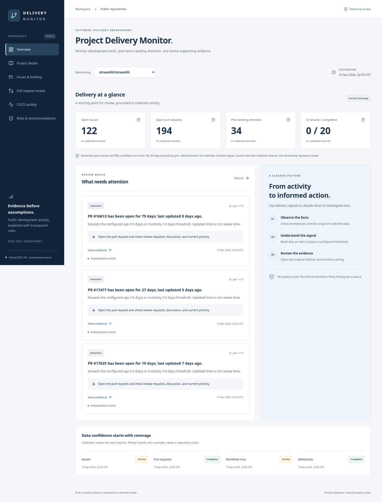
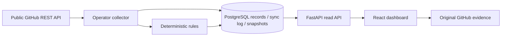

# Project Delivery Monitor

A read-only software delivery dashboard for public GitHub repositories. Review observed issues, pull requests, workflow runs, and milestones; understand why an item needs attention; open the original evidence.

**Status:** live GitHub access and manual collection are verified for Streamlit, Airflow and Next.js in the published cloud environment. The React dashboard displays actual PostgreSQL observations. Large sources remain explicitly partial because of the two-page collection budget. No public deployment or periodic scheduler has been activated. See the [latest audit](docs/AUDIT_REPORT.md), [initial live validation](docs/LIVE_VALIDATION.md), and [preview instructions](docs/PREVIEW.md).



## What works

- Six responsive views: overview, project details/history, issues, PR review, CI activity, and recommendations.
- FastAPI read endpoints, typed responses, bounded pagination and search; no visitor login or sync action.
- GitHub REST collector with validated evidence URLs, pagination, request budgets, bounded retries, rate-limit handling, and a public repository allowlist.
- PostgreSQL normalized records, Alembic migrations, upserts, per-repository advisory locks, sync logs, observation snapshots, and retained data after refresh failures.
- Deterministic PR age/inactivity, repeated CI failure, milestone due-date, and freshness rules. Findings expose evidence, time, policy version, interpretation limits, and a suggested next step.
- A readable text brief with freshness, source coverage, and three evidence-backed findings; the dashboard retains the complete list. Milestones have page navigation. PDF export is deferred.

## Run locally

Requires Python 3.12+, uv, Node 22+, npm, Docker with Compose. Tested here with Python 3.12, Node 24, PostgreSQL 17, and Chromium.

```bash
./scripts/install.sh
# Optional: copy .env.example to .env, preserving any existing .env.
./scripts/start.sh
```

`start.sh` starts PostgreSQL, applies migrations, registers the three allowed repository names (no synthetic metrics), and supervises the API on port 8000 and Vite on port 5173. Use the frontend port in your local browser. Ctrl+C stops the API and frontend; database storage remains in the Compose volume. Backend commands below run from `backend/`, where `../.env` is loaded.

```bash
cd backend
uv run python -m app.jobs.preflight --repo streamlit/streamlit
uv run python -m app.jobs.sync --repo streamlit/streamlit
# One shared request budget across all three repositories:
uv run python -m app.jobs.sync --all
# Connectivity/schema checks only; no database writes:
uv run python -m app.jobs.sync --all --dry-run
```

Preflight exits nonzero on failed checks. Sync exits 1 for failure/busy and 0 for complete or partial collection; inspect the JSON `status` and per-endpoint `coverage`. Partial is not full success. `GITHUB_TOKEN` is optional and server-side only; the unauthenticated quota is shared by outbound IP. After changing environment variables restart the API and collector. Do not put credentials in frontend variables.

Alternative container workflow:

```bash
docker compose up -d --build
# Register configured project identities after migrations:
docker compose exec backend python -m app.jobs.init_db
docker compose exec backend python -m app.jobs.sync --all
```

The Compose password is explicitly local-only and the ports bind to loopback. Use managed credentials and TLS for cloud databases. A proxy-inspected cloud environment needs the trusted CA for Docker builds and runtime; see [deployment notes](docs/DEPLOYMENT.md).

## Verify

```bash
# Create the dedicated test DB once (do not use your application database):
docker compose exec db createdb -U pdm pdm_test
cd backend
uv run alembic check
uv run ruff check .
uv run ruff format --check .
uv run pytest -q
cd ../frontend
npm run lint
npm test
npm run build
# With the app running AFTER real sync (Streamlit needs at least two observations):
PLAYWRIGHT_CHROMIUM_EXECUTABLE=/usr/bin/chromium npm run test:e2e:live
# Regression states use isolated browser fixtures and work with a populated app DB:
PLAYWRIGHT_CHROMIUM_EXECUTABLE=/usr/bin/chromium npm run test:e2e
# Or install Playwright Chromium on your machine: npx playwright install chromium
```

Backend tests use synthetic **TEST DATA** from `backend/tests/fixtures` in the separate `pdm_test` database. Browser regression states use `frontend/tests/fixtures`, intercepting only their own test page's requests. No test data is inserted into the app database and no real observations are cleared. The `test:e2e:live` suite uses the actual API without mocks for all six views, filters, pagination, source links, history, export and screenshots. It also runs automated accessibility checks at desktop/mobile widths; that is not a complete accessibility certification.

To compare stored samples with their GitHub source again, run from `backend/`:

```bash
.venv/bin/python ../scripts/verify_sources.py --output ../docs/evidence/source-recheck.json
```

A mutable upstream title/status may change after collection. A mismatch is reported, not silently substituted into stored observations.

## Architecture



Data sources: [Streamlit](https://github.com/streamlit/streamlit), [Airflow](https://github.com/apache/airflow), and [Next.js](https://github.com/vercel/next.js). These are monitored projects, not implementation frameworks. The frontend uses React/Vite; the backend uses FastAPI, HTTPX, SQLAlchemy, and PostgreSQL. There are no AI runtime dependencies or chat features.

## Interpretation

Public activity cannot establish overall code quality, client deadlines, cost overruns, developer productivity, or production availability. Bounded collection is labeled partial; old data keeps its original timestamp; unknown metrics are never zero-filled. Historical observations are recorded only when collection occurs.

Documentation: [architecture](docs/ARCHITECTURE.md), [metrics and sources](docs/DATA_SOURCES_AND_METRICS.md), [rules](docs/RISK_RULES.md), [test evidence](docs/TEST_EVIDENCE.md), [limitations](docs/LIMITATIONS.md), [deployment](docs/DEPLOYMENT.md), [interview guide](docs/INTERVIEW_GUIDE.md).

**Catatan Indonesia:** aplikasi sudah menampilkan data GitHub nyata dari ketiga repository. Cakupan parsial tetap ditandai. Deployment publik dan penjadwalan periodik belum diaktifkan. Lihat panduan preview untuk melihat tampilan aktual; fixture pengujian tidak masuk ke database aplikasi.
